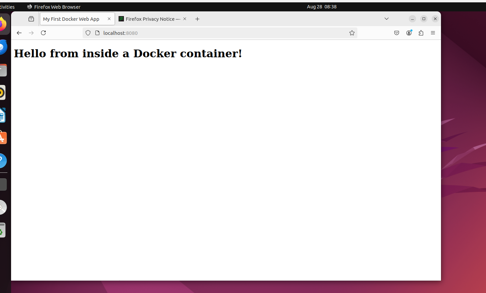

# CSIS 3385 — Database & Web Security

## Project 1B — Docker Web App

**Jack Danford · Austin Community College**

I packaged a static HTML page in an Nginx container and verified that Firefox displayed the page at `localhost:8080`. The [Dockerfile](my-docker-webapp/Dockerfile) uses `nginx:alpine` and serves [index.html](my-docker-webapp/index.html) on container port 80.

### Run locally

From the repository root with Docker running:

```sh
docker build -t csis3385-webapp ./my-docker-webapp
docker run --rm -p 127.0.0.1:8080:80 csis3385-webapp
```

Open `http://localhost:8080`. The page should display **Hello from inside a Docker container!**

### Submission evidence



## Project 3 — Database Schema & ERD

[View the submitted ERD (PDF)](docs/project-3-database-erd.pdf)

I translated an application form into a relational schema. The design maps all 11 fields, uses foreign keys for lookup values, and models an agent's multiple affiliations through a junction table with a composite primary key that prevents duplicate selections.

The diagram documents which rules belong in the database and which require application or transaction logic, including the requirement that a submitted application have at least one affiliation. It also identifies server-side validation, parameterized SQL, and access controls as implementation requirements. The deliverable is a schema design.
